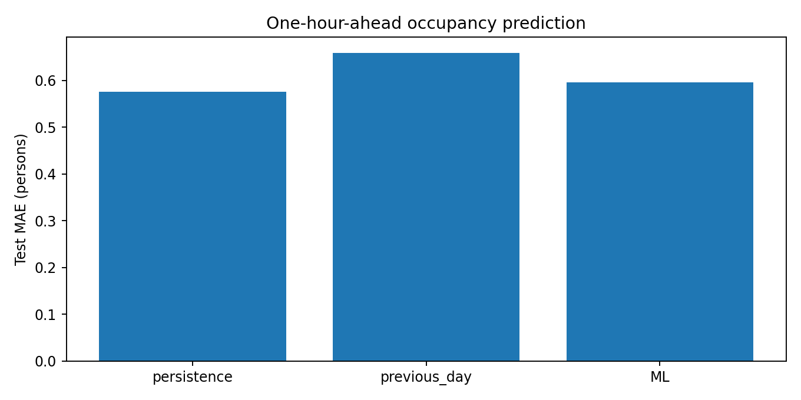
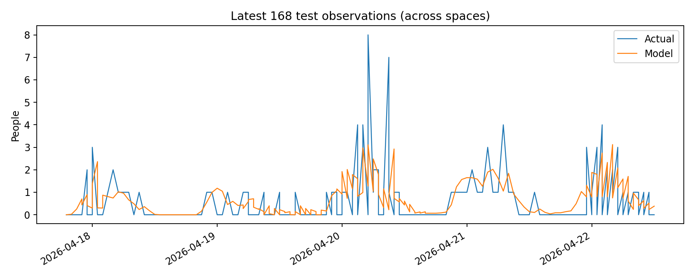

# MMA3001 — Building Occupancy Forecasting

**Author:** NS  
**Course:** MMA3001 — Numerical Methods and Machine Learning

## Project Overview

This project investigates the use of numerical methods and machine learning to forecast building occupancy from historical sensor measurements.

The objective is to predict the number of occupants in a space one hour ahead using previous occupancy measurements and calendar-based features.

The project includes data preprocessing, feature engineering, baseline forecasting methods, machine learning, model evaluation, automated tests, and generated Python documentation.

## Dataset

The project uses building occupancy sensor data supplied for the assignment.

The original compressed dataset contains approximately **9.09 million event records**, with measurements spanning November 2023 to April 2026.

Because the dataset records sensor events rather than regularly spaced observations, the preprocessing pipeline reconstructs hourly occupancy snapshots.

A maximum sensor-reading age of two hours is used. Longer gaps are left missing rather than being treated as zero occupancy.

The original dataset is not included in this repository.

## Methodology

### 1. Data Preprocessing

The pipeline reads the compressed CSV dataset, extracts the required fields, processes timestamps, and reconstructs hourly occupancy states.

### 2. Feature Engineering

Historical occupancy features are joined using exact timestamps to prevent irregular observations from being mistaken for consecutive hours.

Features include:

- Current and historical occupancy measurements
- Occupancy from the previous day
- Hour of day
- Day of week
- Weekend indicator

The prediction target is occupancy one hour after the current observation.

### 3. Forecasting Models

Three forecasting approaches are compared:

- **Persistence baseline:** Assumes occupancy will remain unchanged.
- **Previous-day baseline:** Uses occupancy at the corresponding hour on the previous day.
- **Machine learning:** Uses a histogram-based gradient boosting regressor trained on historical and calendar features.

### 4. Model Evaluation

Data is divided chronologically into training, validation, and testing partitions using a 60/20/20 split.

Performance is evaluated using:

- Mean Absolute Error (MAE)
- Root Mean Squared Error (RMSE)

Both metrics are expressed in numbers of occupants. Lower values indicate better predictions.

## Results

The corrected experiment generated **50,398 eligible feature rows** across **four modelled spaces**.

| Forecasting Method | MAE | RMSE |
|---|---:|---:|
| Persistence baseline | 0.7465 | 1.7242 |
| Previous-day baseline | 0.8714 | 1.9223 |
| Machine learning | **0.7280** | **1.3785** |

The machine learning model achieved the lowest overall MAE and RMSE among the three approaches.

Compared with the persistence baseline, the machine learning model reduced MAE by approximately 2.5% and RMSE by approximately 20.0%.

### Model Comparison



### Example Forecasts



## Repository Structure

```text
MMA3001-Occupancy-Forecasting/
├── data/
├── docs/
├── results/
│   ├── metrics.json
│   ├── model_comparison.png
│   ├── test_predictions.csv
│   └── test_predictions.png
├── src/
│   ├── __init__.py
│   └── pipeline.py
├── tests/
│   └── test_pipeline.py
├── requirements.txt
├── README.md
└── LICENSE
```

## Running the Project

Install the required Python packages:

```bash
pip install -r requirements.txt
```

Place the original occupancy dataset ZIP file on your computer, then run:

```bash
python -m src.pipeline --zip "path/to/occupancy.zip"
```

The pipeline generates evaluation metrics, prediction data, and plots in the `results` directory.

## Testing

Run the automated tests using:

```bash
python -m pytest tests/
```

## Documentation

Generated API documentation is available in [`docs/index.html`](docs/index.html).

It describes the functions used for loading data, reconstructing hourly observations, generating features, splitting data, evaluating forecasts, and running the experiment.

## Limitations

- Sensor observations are irregular and some time periods contain missing data.
- Results are based on four spaces with sufficient usable observations.
- Historical data coverage differs between spaces.
- Calendar features are calculated using UTC timestamps rather than local building time.
- Model performance may differ when evaluated on new buildings or future data.

## AI Assistance

AI assistance was used during development for guidance with Python implementation, debugging, testing, documentation, and interpretation of results. Generated code and outputs were checked through execution and testing.

Any additional AI-use declaration required by the university should be included in the assignment submission.
